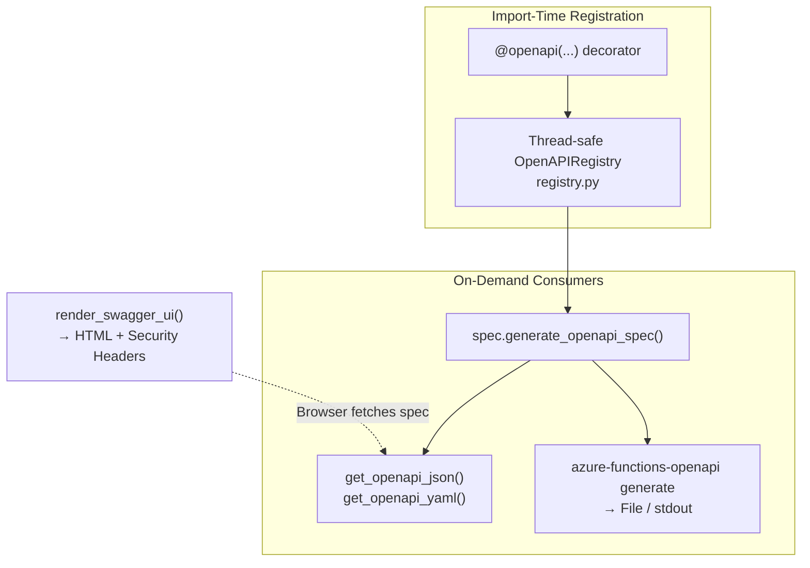

# DESIGN.md

Design Principles for `azure-functions-openapi`

## Purpose

This document defines the architectural boundaries and design principles of the project.

## Design Goals

- Generate OpenAPI documents for Azure Functions Python v2 handlers.
- Keep the decorator model explicit and predictable.
- Preserve Azure Functions runtime behavior instead of abstracting it away.
- Provide Swagger UI and CLI tooling without turning the package into a framework.

## Non-Goals

This project does not aim to:

- Replace Azure Functions routing or hosting behavior
- Hide the `func.FunctionApp()` programming model
- Become a general web framework
- Own deployment, infrastructure, or application lifecycle concerns

## Design Principles

- Explicit metadata is preferred over magic inference.
- Decorators should collect metadata, not change core handler semantics.
- OpenAPI generation and UI rendering should remain separate concerns.
- Public APIs should evolve conservatively.
- Example applications should demonstrate supported patterns, not internal shortcuts.

## Architecture

### Core Mechanism: Import-Time Registration + On-Demand Compilation

The architecture separates metadata capture (import-time) from document generation (request-time or CLI-time). The `@openapi` decorator collects metadata into a thread-safe registry; the spec compiler and CLI read the registry to produce OpenAPI documents. Swagger UI rendering is a separate concern that does not access the registry.

Note: `render_swagger_ui()` does not embed or generate the OpenAPI spec. It returns HTML that instructs the browser to fetch the spec from a configured URL.

An explicit Python `app=` or CLI `module:variable` selects an app-scoped registry.
Discovery reuses the existing seed-on-scan mechanism, copying decorator metadata
by canonical handler identity and reconciling only the selected app's bindings.
The default global registry is not mutated. Module-only CLI generation and Python
generation without `app` retain global aggregation. An explicitly injected Python
registry retains caller-owned additive behavior, including programmatic entries.

### Schema Version Conversion

Before #819: `spec.py` assembled operations, recursively translated schemas,
audited 3.0 compatibility, and maintained generation diagnostics in the registry;
reports and the CLI reconstructed those events from mutable registry channels.

After #819: `spec.py` owns document compilation and diagnostic policy;
`_schema_version_conversion.py` owns the intact schema conversion family behind
a schema-only seam. Its inputs are schema data, the original complete component
map, recursion guards, and optional loss accumulators. It has no registry,
discovery, logging, or CLI dependency. Private imports from `spec` remain available
as compatibility re-exports. No plugin or pipeline abstraction is introduced.

The final call-flow is:

1. Snapshot metadata and scan-lifetime warnings; assemble operations and hoist
   definitions into the complete component map. Compilation events accumulate
   locally rather than updating the registry during the walk.
2. Convert inline request, response (including `itemSchema`), and parameter schemas:
   3.1 and 3.2 use `_convert_operation_schemas_to_3_1` for legacy nullable/example
   syntax; 3.0 uses `_convert_operation_schemas_to_3_0` for nullable unions, refs,
   and other downgrade forms, recording losses in encounter order. Inline nullable
   refs resolve against the **original complete component map**, before replacement.
3. Convert named components separately with `_convert_schemas_to_3_1` or
   `_convert_schemas_to_3_0`: inline schemas and components are distinct locations,
   not duplicate passes. The 3.0 component conversion also resolves refs against
   the original map, replacing it only after all converted components are returned.
4. For 3.0, retain the residual compatibility audit after conversion:
   `_check_operation_schemas_3_0_compatible` for inline operation schemas and
   `_check_schemas_3_0_compatible` for components. Each rejects (strict) or reports
   a `type` array or null-`anyOf` that conversion could not normalize, naming the
   construct and where it was found. Conversion rewrites non-null `type` arrays to
   `anyOf` except beside a `discriminator`, which a combinator would activate, and
   faithfully converted schemas must not trigger the audit. Non-strict findings
   join the schema-loss findings below rather than being logged on their own.
   Keywords OpenAPI 3.0 does not define are not audited.
5. Normalize and validate the document before custom-method relocation and QUERY
   removal. Relocate custom methods for 3.2; record unsupported method/QUERY drops
   before 3.2. Append schema-loss findings, log findings, and enforce strict mode.
6. Publish the compatibility diagnostic snapshot, including on compilation failure.
   Runtime serialization stops here; reports and the CLI consume invocation-local
   results and only repeat validation when operation traversal changed. Standalone
   warning collection always validates its supplied document.

The boundary removes recursive conversion details from the compiler's policy
surface and prevents conversion from acquiring registry/CLI state dependencies.
It does not claim fewer schema walks: referenced subtrees and pattern-property
approximations can still be revisited. Exact output and loss-message-order
equivalence has not been established for removing those visits, so they remain.
Both nullable-combinator collapse calls also remain: the pre-recursion call sees
null sentinel types that recursive conversion removes, while the post-recursion
call processes the resulting structure. The family is deliberately kept in one
module rather than split again merely to reduce line count.

### Generation Diagnostics

Compilation accumulates duplicate operations, downgrade drops, schema substitutions,
and skipped operations in invocation-local lists. On exit, a single registry-locked
publication replaces all four compatibility channels using the existing clear/add
methods. This keeps `generate_openapi_spec(registry=reg)` followed by
`collect_spec_warnings(spec, registry=reg)` compatible, including registry-owned
deduplication and sorting, without using the registry as a live compiler accumulator.

Publication also runs after compilation raises: the snapshot contains only events
recorded before the failure, preserving the previous exception-state contract.
Invalid configuration or an entry-snapshot failure before compilation starts leaves
the previous diagnostics unchanged. Discovery warnings and empty discoveries retain
their scan lifetime and are never cleared by this publication.

Reports and the CLI consume an internal generation result containing the document,
invocation-local diagnostic tuple, pre-transform validation messages and an
operation-traversal change flag. They do not reconstruct generation events from the
registry's mutable compatibility snapshot. Scan-lifetime warnings are captured at
the start of that invocation; unresolved-route warnings still come from facade/CLI
preparation and remain advisory.

Before: compile -> validate -> relocate/drop -> publish -> report/CLI reads registry
channels -> validate final document again.

After: compile -> validate -> relocate/drop -> publish -> report/CLI consumes local
result -> reuse validation only when operation traversal is unchanged. Custom-method
relocation (including 3.2) and pre-3.2 QUERY removal require final-document validation:
relocation can change duplicate-operation-id encounter order. Generation logs and
strict-mode failures retain pre-transform messages plus downgrade findings. Plain
runtime JSON/YAML generation never performs this final report-only validation walk.
Standalone `collect_spec_warnings(spec, registry)` always validates its supplied
document, including one modified after generation or supplied by a mock.

Protected docs can opt into browser-owned key forwarding: the library's header-mode
handler does not read or echo the query value, while the Functions host necessarily
receives the initial URL. A nonce-protected script removes `code` from the
page URL before loading Swagger UI and adds `x-functions-key` only to the exact
same-origin spec download (`loadSpec`), never API operations. Absolute HTTPS
spec URLs are non-forwardable; protocol-relative URLs are rejected. Legacy query
forwarding remains the default with a protected-registration deprecation warning.
Key-bearing specification fetches use `redirect: 'error'`: a redirect fails closed
with Swagger UI's normal load error and no request to its destination. Address-bar
cleanup cannot erase earlier logs/history or page-lifetime browser memory:
`performance.getEntriesByType("navigation")[0].name` retains the original `?code=`
URL after `history.replaceState`.

## Integration Boundaries

- Runtime validation belongs to `azure-functions-validation`.
- Diagnostics belong to `azure-functions-doctor`.
- This repository owns OpenAPI metadata capture, document generation, and documentation UI helpers.
- When explicit `@openapi` metadata and validation-discovered metadata describe
  the same operation, explicit prose wins while schemas must be compatible.
  Response model classes are resolved through the shared schema compiler before
  comparison, so duplicate declarations of the same model collapse to one
  response; incompatible response, request-body, or parameter schemas fail with
  endpoint- and source-aware diagnostics.

## Compatibility Policy

- Minimum supported Python version: `3.11`
- Supported runtime target: Azure Functions Python v2 programming model
- Public APIs follow semantic versioning expectations

## Change Discipline

- Changes to decorator behavior require strong regression coverage.
- Changes to generated spec defaults must be treated as user-facing behavior changes.
- Experimental APIs must be clearly labeled in code and docs.

## Sources

- [Azure Functions Python developer reference](https://learn.microsoft.com/en-us/azure/azure-functions/functions-reference-python)
- [Azure Functions HTTP trigger](https://learn.microsoft.com/en-us/azure/azure-functions/functions-bindings-http-webhook-trigger)
- [Supported languages in Azure Functions](https://learn.microsoft.com/en-us/azure/azure-functions/supported-languages)

## See Also

- [azure-functions-validation — Architecture](https://github.com/yeongseon/azure-functions-validation-python) — Request/response validation pipeline
- [azure-functions-logging — Architecture](https://github.com/yeongseon/azure-functions-logging-python) — Structured logging with contextvars
- [azure-functions-doctor — Architecture](https://github.com/yeongseon/azure-functions-doctor-python) — Pre-deploy diagnostic CLI
- [azure-functions-scaffold — Architecture](https://github.com/yeongseon/azure-functions-scaffold-python) — Project scaffolding CLI
- [azure-functions-langgraph — Architecture](https://github.com/yeongseon/azure-functions-langgraph-python) — LangGraph agent deployment
