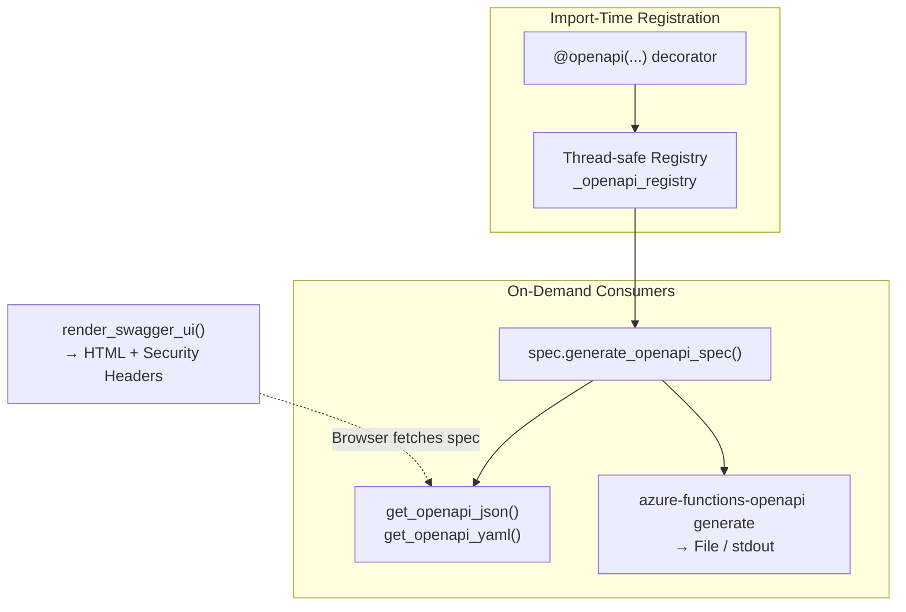

# DESIGN.md

Design Principles for `azure-functions-openapi`

## Purpose

This document defines the architectural boundaries and design principles of the project.

## Design Goals

- Generate OpenAPI documents for Azure Functions Python v2 handlers.
- Keep the decorator model explicit and predictable.
- Preserve Azure Functions runtime behavior instead of abstracting it away.
- Provide Swagger UI and CLI tooling without turning the package into a framework.

## Non-Goals

This project does not aim to:

- Replace Azure Functions routing or hosting behavior
- Hide the `func.FunctionApp()` programming model
- Become a general web framework
- Own deployment, infrastructure, or application lifecycle concerns

## Design Principles

- Explicit metadata is preferred over magic inference.
- Decorators should collect metadata, not change core handler semantics.
- OpenAPI generation and UI rendering should remain separate concerns.
- Public APIs should evolve conservatively.
- Example applications should demonstrate supported patterns, not internal shortcuts.

## Architecture

### Core Mechanism: Import-Time Registration + On-Demand Compilation

The architecture separates metadata capture (import-time) from document generation (request-time or CLI-time). The `@openapi` decorator collects metadata into a thread-safe registry; the spec compiler and CLI read the registry to produce OpenAPI documents. Swagger UI rendering is a separate concern that does not access the registry.

Note: `render_swagger_ui()` does not embed or generate the OpenAPI spec. It returns HTML that instructs the browser to fetch the spec from a configured URL.

### Generation Diagnostics

Compilation accumulates duplicate operations, downgrade drops, schema substitutions,
and skipped operations in invocation-local lists. On exit, a single registry-locked
publication replaces all four compatibility channels using the existing clear/add
methods. This keeps `generate_openapi_spec(registry=reg)` followed by
`collect_spec_warnings(spec, registry=reg)` compatible, including registry-owned
deduplication and sorting, without using the registry as a live compiler accumulator.

Publication also runs after compilation raises: the snapshot contains only events
recorded before the failure, preserving the previous exception-state contract.
Invalid configuration or an entry-snapshot failure before compilation starts leaves
the previous diagnostics unchanged. Discovery warnings and empty discoveries retain
their scan lifetime and are never cleared by this publication.

Protected docs can opt into browser-owned key forwarding: the library's header-mode
handler does not read or echo the query value, while the Functions host necessarily
receives the initial URL. A nonce-protected script removes `code` from the
page URL before loading Swagger UI and adds `x-functions-key` only to the exact
same-origin spec download (`loadSpec`), never API operations. Absolute HTTPS
spec URLs are non-forwardable; protocol-relative URLs are rejected. Legacy query
forwarding remains the default with a protected-registration deprecation warning.
Key-bearing specification fetches use `redirect: 'error'`: a redirect fails closed
with Swagger UI's normal load error and no request to its destination. Address-bar
cleanup cannot erase earlier logs/history or page-lifetime browser memory:
`performance.getEntriesByType("navigation")[0].name` retains the original `?code=`
URL after `history.replaceState`.

## Integration Boundaries

- Runtime validation belongs to `azure-functions-validation`.
- Diagnostics belong to `azure-functions-doctor`.
- This repository owns OpenAPI metadata capture, document generation, and documentation UI helpers.
- When explicit `@openapi` metadata and validation-discovered metadata describe
  the same operation, explicit prose wins while schemas must be compatible.
  Response model classes are resolved through the shared schema compiler before
  comparison, so duplicate declarations of the same model collapse to one
  response; incompatible response, request-body, or parameter schemas fail with
  endpoint- and source-aware diagnostics.

## Compatibility Policy

- Minimum supported Python version: `3.11`
- Supported runtime target: Azure Functions Python v2 programming model
- Public APIs follow semantic versioning expectations

## Change Discipline

- Changes to decorator behavior require strong regression coverage.
- Changes to generated spec defaults must be treated as user-facing behavior changes.
- Experimental APIs must be clearly labeled in code and docs.

## Sources

- [Azure Functions Python developer reference](https://learn.microsoft.com/en-us/azure/azure-functions/functions-reference-python)
- [Azure Functions HTTP trigger](https://learn.microsoft.com/en-us/azure/azure-functions/functions-bindings-http-webhook-trigger)
- [Supported languages in Azure Functions](https://learn.microsoft.com/en-us/azure/azure-functions/supported-languages)

## See Also

- [azure-functions-validation — Architecture](https://github.com/yeongseon/azure-functions-validation-python) — Request/response validation pipeline
- [azure-functions-logging — Architecture](https://github.com/yeongseon/azure-functions-logging-python) — Structured logging with contextvars
- [azure-functions-doctor — Architecture](https://github.com/yeongseon/azure-functions-doctor-python) — Pre-deploy diagnostic CLI
- [azure-functions-scaffold — Architecture](https://github.com/yeongseon/azure-functions-scaffold-python) — Project scaffolding CLI
- [azure-functions-langgraph — Architecture](https://github.com/yeongseon/azure-functions-langgraph-python) — LangGraph agent deployment
